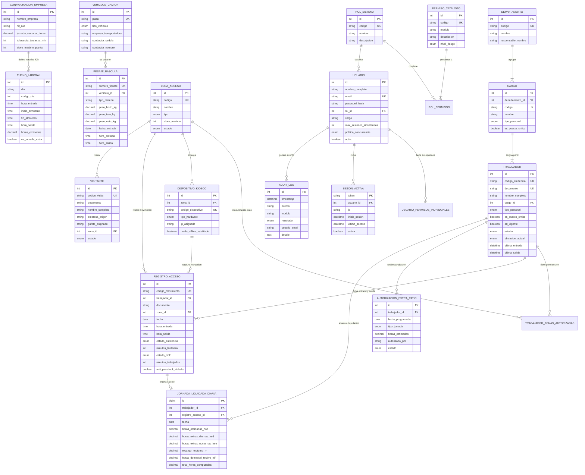

# 🗄️ Modelo Entidad-Relación (MER) y Modelo Relacional Físico
## Sistema Integral de Control de Acceso, Asistencia 42h y Portería Industrial
### Empresa: Recuperaciones Naranjo Recycling S.A.S. — Sede Cartagena de Indias (Bolívar, Colombia)

> **Documento Oficial de Diseño de Base de Datos (3NF / ANSI SQL)**  
> **Motor Soportado:** MySQL 8.0+ / MariaDB 10.5+ / PostgreSQL 15+ / SQLite Edge  
> **Archivo de Definición DDL / DML:** [`database/schema.sql`](../database/schema.sql)  
> **Régimen Laboral Soportado:** 42 Horas Semanales (Ley 2101 de 2021 / Código Sustantivo del Trabajo)

---

## 📑 Contenido del Documento
1. [Visión General del Modelo de Datos Corporativo](#1-visión-general-del-modelo-de-datos-corporativo)
2. [Modelo Entidad-Relación Conceptual y Lógico (MER / ERD)](#2-modelo-entidad-relación-conceptual-y-lógico-mer--erd)
3. [Diagrama Entidad-Relación Completo en Mermaid](#3-diagrama-entidad-relación-completo-en-mermaid)
4. [Modelo Relacional Físico Normalizado (Tercera Forma Normal - 3NF)](#4-modelo-relacional-físico-normalizado-tercera-forma-normal---3nf)
5. [Diccionario Exhaustivo de Datos (Estructura de Tablas Físicas)](#5-diccionario-exhaustivo-de-datos-estructura-de-tablas-físicas)
6. [Reglas de Integridad Referencial y Restricciones (Constraints)](#6-reglas-de-integridad-referencial-y-restricciones-constraints)
7. [Vistas Analíticas y Procedimientos / Disparadores (Triggers)](#7-vistas-analíticas-y-procedimientos--disparadores-triggers)
8. [Matriz de Trazabilidad con Cargos Reales de Recuperaciones Naranjo](#8-matriz-de-trazabilidad-con-cargos-reales-de-recuperaciones-naranjo)

---

## 1. Visión General del Modelo de Datos Corporativo

El modelo de datos de **Recuperaciones Naranjo Recycling S.A.S.** fue concebido para resolver las necesidades operativas de una planta de reciclaje de metales pesados en la Zona Industrial de Mamonal (Cartagena):
- **Identificación Instantánea por Cédula:** El número de documento (Cédula de Ciudadanía Colombiana) es el identificador primario de consulta rápida para el operario en garita peatonal.
- **Diferenciación de Criticidad Operativa:** La estructura distingue entre puestos críticos cuya ausencia paraliza la producción (Operador Grúa Pulpo #1, Grúa Pulpo #2, Montacargas, Mecánico de Planta) frente a roles administrativos y aprendices SENA.
- **Régimen de 42 Horas Semanales (Ley 2101):** La parametrización horaria no asume jornadas uniformes de 8 horas, sino la regla exacta corporativa de lunes a viernes: Lunes 7.0h (almuerzo 1.5h), Martes/Viernes 8.5h (almuerzo 1h) y Miércoles/Jueves 9.0h (almuerzo 1h), computando recargos automáticos para sábados y domingos.
- **Seguridad e IAM con Cero Confianza (Zero-Trust):** Control de acceso administrativo independiente con roles, permisos granulares con capacidad de sobreescritura (`ALLOW`/`DENY`) y control de sesiones activas.

---

## 2. Modelo Entidad-Relación Conceptual y Lógico (MER / ERD)

### 2.1 Clasificación de Entidades
1. **Entidades Fuertes (Independientes):**
   - `CONFIGURACION_EMPRESA`: Parámetros maestros de la sede Cartagena.
   - `DEPARTAMENTO`: Áreas operativas y administrativas.
   - `ZONA_ACCESO`: Zonas físicas de la planta industrial.
   - `PERMISO_CATALOGO`: Catálogo atómico de privilegios de seguridad.
   - `ROL_SISTEMA`: Agrupaciones jerárquicas de roles.
   - `TURNO_LABORAL`: Reglas horarias semanales de 42 horas.
   - `VEHICULO_CAMION`: Registro de camiones y volquetas de carga pesada.
2. **Entidades Débiles (Dependientes de Existencia):**
   - `CARGO`: Depende funcionalmente de `DEPARTAMENTO`.
   - `TRABAJADOR`: Depende de `CARGO` y parametriza al colaborador.
   - `REGISTRO_ACCESO`: Depende de `TRABAJADOR`, `ZONA_ACCESO` y `DISPOSITIVO`.
   - `JORNADA_LIQUIDADA`: Depende de `TRABAJADOR` y de las marcaciones de un día.
   - `AUTORIZACION_EXTRA`: Depende de `TRABAJADOR` y del supervisor autorizador.
   - `PESAJE_BASCULA`: Depende de `VEHICULO_CAMION`.
   - `USUARIO`: Depende de `ROL_SISTEMA`.
   - `SESION_ACTIVA`: Depende de `USUARIO`.
   - `AUDIT_LOG`: Depende del usuario o terminal emisor.
3. **Entidades Asociativas (Relaciones Muchos a Muchos - N:M):**
   - `TRABAJADOR_ZONAS_AUTORIZADAS`: Resuelve la relación N:M entre `TRABAJADOR` y `ZONA_ACCESO`.
   - `ROL_PERMISOS`: Resuelve la relación N:M entre `ROL_SISTEMA` y `PERMISO_CATALOGO`.
   - `USUARIO_PERMISOS_INDIVIDUALES`: Resuelve excepciones de privilegios (`ALLOW`/`DENY`) por usuario.

---

## 3. Diagrama Entidad-Relación Completo en Mermaid

El siguiente diagrama formal representa el modelo conceptual y lógico completo de la base de datos:

---

## 4. Modelo Relacional Físico Normalizado (Tercera Forma Normal - 3NF)

El diseño relacional satisface estrictamente las tres formas normales:
1. **Primera Forma Normal (1NF):** Todos los atributos son atómicos; no existen campos repetitivos ni listas incrustadas. Las zonas autorizadas por trabajador y los permisos por rol se modularizaron en tablas asociativas formales.
2. **Segunda Forma Normal (2NF):** Todas las tablas poseen una Clave Primaria definida (`PK`) y ningún atributo no clave depende de una parte de una clave compuesta.
3. **Tercera Forma Normal (3NF):** No existen dependencias transitivas entre atributos no clave; los nombres de cargos, departamentos y roles se resuelven mediante sus respectivas llaves foráneas (`FK`), evitando redundancias o anomalías de actualización.

### Esquema Relacional Formal (Notación de Tablas):
* **CONFIGURACION_EMPRESA** (**`id`**, nombre_empresa, nit_ruc, rubro, direccion, ciudad, telefono, email, tolerancia_tardanza_min, aforo_maximo_planta, jornada_semanal_horas, regimen_laboral)
* **TURNOS_LABORALES** (**`id`**, dia, codigo_dia, hora_entrada, inicio_almuerzo, fin_almuerzo, duracion_almuerzo_min, hora_salida, horas_ordinarias, aplica_administracion, aplica_patio, es_jornada_extra)
* **CONCEPTOS_RECARGOS_LEY2101** (**`id`**, `codigo` [UK], nombre, factor_multiplicador, porcentaje_recargo, franja_inicio, franja_fin, aplica_festivos)
* **DEPARTAMENTOS** (**`id`**, `codigo` [UK], nombre, descripcion, responsable_nombre, ubicacion_planta)
* **CARGOS** (**`id`**, *`departamento_id`* [FK], `codigo` [UK], nombre, tipo_personal, es_puesto_critico, descripcion_funciones)
* **ZONAS_ACCESO** (**`id`**, `codigo` [UK], nombre, tipo, nivel_seguridad, ubicacion, aforo_maximo, estado)
* **DISPOSITIVOS_KIOSCO** (**`id`**, *`zona_id`* [FK], `codigo_dispositivo` [UK], nombre, tipo_hardware, ip_asignada, modo_offline_habilitado, estado_conexion)
* **TRABAJADORES** (**`id`**, `codigo_credencial` [UK], `documento` [UK], nombres, apellidos, nombre_completo, *`cargo_id`* [FK], tipo_personal, es_puesto_critico, turno_id, telefono, email, arl_vigente, estado, ubicacion_actual, ultima_entrada, ultima_salida, foto_url)
* **TRABAJADOR_ZONAS_AUTORIZADAS** (**`id`**, *`trabajador_id`* [FK], *`zona_id`* [FK], nivel_permiso, asignado_en)
* **REGISTROS_ACCESO** (**`id`**, `codigo_movimiento` [UK], *`trabajador_id`* [FK], documento, trabajador_nombre, departamento, *`zona_id`* [FK], fecha, hora_entrada, hora_salida, estado_asistencia, minutos_tardanza, estado_ciclo, minutos_trabajados, metodo_identificacion, anti_passback_violado)
* **AUTORIZACIONES_EXTRAS_PATIO** (**`id`**, *`trabajador_id`* [FK], nombre_trabajador, fecha_programada, dia, tipo_jornada, horas_estimadas, motivo, autorizado_por, estado)
* **JORNADAS_LIQUIDADAS_DIARIAS** (**`id`**, *`trabajador_id`* [FK], *`registro_acceso_id`* [FK], fecha, dia_semana, hora_entrada_real, hora_salida_real, minutos_almuerzo_descontados, horas_ordinarias_hod, horas_extras_diurnas_hed, horas_extras_nocturnas_hen, recargo_nocturno_rn, horas_dominical_festivo_rdf, total_horas_computadas, estado_liquidacion)
* **VEHICULOS_CAMIONES_CHATARRA** (**`id`**, `placa` [UK], tipo_vehiculo, empresa_transportadora, conductor_cedula, conductor_nombre, conductor_telefono, soat_vigente, tecnomecanica_vigente, estado)
* **PESAJES_BASCULA** (**`id`**, `numero_tiquete` [UK], *`vehiculo_id`* [FK], conductor_nombre, conductor_documento, empresa_cliente_proveedor, tipo_operacion, tipo_material, peso_bruto_kg, peso_tara_kg, peso_neto_kg, fecha_entrada, hora_entrada, hora_salida, operador_bascula, estado)
* **VISITANTES** (**`id`**, `codigo_visita` [UK], nombre_completo, documento, empresa_origen, placa_vehiculo, motivo_visita, anfitrion_visitado, gafete_asignado, *`zona_id`* [FK], fecha, hora_ingreso, hora_salida, arl_verificada, estado)
* **INCIDENCIAS_ACCESO** (**`id`**, fecha_hora, trabajador_nombre, documento, zona_nombre, tipo_alerta, severidad, detalle, estado_resolucion, registrado_por)
* **PERMISOS_CATALOGO** (**`id`**, `codigo` [UK], modulo, descripcion, nivel_riesgo)
* **ROLES_SISTEMA** (**`id`**, `codigo` [UK], nombre, descripcion, es_rol_sistema)
* **ROL_PERMISOS** (**`id`**, *`rol_id`* [FK], *`permiso_id`* [FK])
* **USUARIOS** (**`id`**, nombre_completo, `email` [UK], password_hash, *`rol_id`* [FK], rol, cargo, max_sesiones_simultaneas, politica_concurrencia, activo)
* **USUARIO_PERMISOS_INDIVIDUALES** (**`id`**, *`usuario_id`* [FK], permiso_codigo, accion, motivo_excepcion)
* **SESIONES_ACTIVAS** (**`token`** [PK], *`usuario_id`* [FK], usuario_email, usuario_rol, dispositivo, ip, inicio_sesion, ultimo_acceso, activa)
* **AUDIT_LOGS** (**`id`**, timestamp, evento, modulo, permiso_evaluado, resultado, usuario_email, ip, detalle)

---

## 5. Diccionario Exhaustivo de Datos (Estructura de Tablas Físicas)

A continuación se detalla la especificación de campos de las tablas centrales del sistema:

### 5.1 Tabla: `trabajadores`
Almacena el padrón oficial de colaboradores de Recuperaciones Naranjo.

| Columna | Tipo de Dato | Nulo | Clave | Valor por Defecto | Descripción y Regla de Negocio |
| :--- | :--- | :---: | :---: | :---: | :--- |
| `id` | INT | NO | **PK** | AUTO_INCREMENT | Identificador numérico interno autoincremental |
| `codigo_credencial` | VARCHAR(30) | NO | **UK** | Ninguno | Código corporativo de carnet (ej. `RN-PAT-001`) |
| `documento` | VARCHAR(30) | NO | **UK** | Ninguno | Cédula de Ciudadanía colombiana física |
| `nombres` | VARCHAR(80) | NO | | Ninguno | Nombres del colaborador |
| `apellidos` | VARCHAR(80) | NO | | Ninguno | Apellidos del colaborador |
| `nombre_completo` | VARCHAR(160) | NO | | Ninguno | Nombre consolidado para visualización en pantalla |
| `cargo_id` | INT | NO | **FK** | Ninguno | Enlace al cargo oficial en `cargos(id)` |
| `tipo_personal` | ENUM | NO | | 'PATIO' | `PATIO`, `ADMINISTRACION` o `APRENDIZ_SENA` |
| `es_puesto_critico` | BOOLEAN | NO | | FALSE | Si es TRUE activa alerta a 15 min si está ausente |
| `turno_id` | INT | NO | | 1 | Turno base semanal asignado |
| `telefono` | VARCHAR(30) | SÍ | | NULL | Celular de contacto personal |
| `email` | VARCHAR(100) | SÍ | | NULL | Correo corporativo o personal |
| `arl_vigente` | BOOLEAN | NO | | TRUE | Estado de afiliación a ARL (SST obligatorio) |
| `estado` | ENUM | NO | | 'ACTIVO' | `ACTIVO`, `SUSPENDIDO` (bloquea acceso) o `INACTIVO` |
| `ubicacion_actual` | ENUM | NO | | 'FUERA_PLANTA' | `DENTRO_PLANTA` o `FUERA_PLANTA` |
| `ultima_entrada` | DATETIME | SÍ | | NULL | Timestamp del último ingreso registrado |
| `ultima_salida` | DATETIME | SÍ | | NULL | Timestamp de la última salida registrada |
| `foto_url` | VARCHAR(255) | SÍ | | NULL | URL / Path de fotografía oficial para cotejo |

### 5.2 Tabla: `turnos_laborales`
Define la distribución oficial de las **42 Horas Semanales (Ley 2101 / CST)**.

| Columna | Tipo de Dato | Nulo | Clave | Valor por Defecto | Descripción y Regla de Negocio |
| :--- | :--- | :---: | :---: | :---: | :--- |
| `id` | INT | NO | **PK** | AUTO_INCREMENT | Identificador del día de turno |
| `dia` | VARCHAR(25) | NO | | Ninguno | Nombre del día (Lunes a Domingo) |
| `codigo_dia` | INT | NO | | Ninguno | 0=Dom, 1=Lun, 2=Mar, 3=Mié, 4=Jue, 5=Vie, 6=Sáb |
| `hora_entrada` | TIME | NO | | Ninguno | Hora de inicio oficial del turno diario |
| `inicio_almuerzo` | TIME | NO | | Ninguno | Inicio del período de alimentación |
| `fin_almuerzo` | TIME | NO | | Ninguno | Finalización del descanso |
| `duracion_almuerzo_min` | INT | NO | | Ninguno | Minutos descontados (Lunes 90m, Mar-Vie 60m) |
| `hora_salida` | TIME | NO | | Ninguno | Hora oficial de finalización de jornada |
| `horas_ordinarias` | DECIMAL(4,2) | NO | | Ninguno | Horas computadas (Lun 7.0, Mar/Vie 8.5, Mié/Jue 9.0) |
| `aplica_patio` | BOOLEAN | NO | | TRUE | Si aplica para cuadrilla y maquinaria de patio |
| `aplica_administracion`| BOOLEAN | NO | | TRUE | Si aplica para personal administrativo |
| `es_jornada_extra` | BOOLEAN | NO | | FALSE | TRUE para sábados y domingos de patio |

### 5.3 Tabla: `registros_acceso`
Almacena cada fichaje con Cédula en el Kiosco y calcula los tiempos trabajados.

| Columna | Tipo de Dato | Nulo | Clave | Valor por Defecto | Descripción y Regla de Negocio |
| :--- | :--- | :---: | :---: | :---: | :--- |
| `id` | INT | NO | **PK** | AUTO_INCREMENT | Identificador del movimiento de acceso |
| `codigo_movimiento` | VARCHAR(40) | NO | **UK** | Ninguno | Hash único de trazabilidad (ej. `MOV-20261023-001`) |
| `trabajador_id` | INT | NO | **FK** | Ninguno | Referencia obligatoria a `trabajadores(id)` |
| `documento` | VARCHAR(30) | NO | | Ninguno | Cédula digitada o escaneada |
| `zona_id` | INT | NO | **FK** | Ninguno | Zona física donde se ubicó el terminal |
| `fecha` | DATE | NO | | Ninguno | Fecha de la jornada laboral |
| `hora_entrada` | TIME | NO | | Ninguno | Hora de fichaje de ingreso a planta |
| `hora_salida` | TIME | SÍ | | NULL | Hora de fichaje de egreso de planta |
| `estado_asistencia` | ENUM | NO | | 'PUNTUAL' | `PUNTUAL`, `TARDANZA`, `EXTRAORDINARIA` |
| `minutos_tardanza` | INT | NO | | 0 | Minutos excedidos tras tolerancia oficial de 10 min |
| `estado_ciclo` | ENUM | NO | | 'EN_PLANTA' | `EN_PLANTA` (ingreso abierto) o `FINALIZADO` |
| `minutos_trabajados` | INT | SÍ | | NULL | Minutos netos laborados tras registrar salida |
| `horas_formateadas` | VARCHAR(50) | SÍ | | NULL | Texto legible (ej. `8h 34min`) |
| `metodo_identificacion`| ENUM | NO | | 'TERMINAL_KIOSCO_PIN'| `PIN_TECLADO`, `CODIGO_BARRAS_CC`, `RFID` |
| `anti_passback_violado`| BOOLEAN | NO | | FALSE | Alerta si intentó marcar doble entrada sin salir |

---

## 6. Reglas de Integridad Referencial y Restricciones (Constraints)

1. **Restricción de Eliminación en Maestro de Cargos y Departamentos:**  
   `cargos(departamento_id) REFERENCES departamentos(id) ON DELETE RESTRICT`  
   *Regla:* No es posible eliminar un departamento si existen cargos asignados a él.
2. **Restricción de Eliminación en Trabajadores:**  
   `registros_acceso(trabajador_id) REFERENCES trabajadores(id) ON DELETE RESTRICT`  
   *Regla:* Un operario con historial de fichajes no puede ser eliminado físicamente; debe cambiarse su estado a `INACTIVO` o `SUSPENDIDO` para preservar la trazabilidad fiscal y de nómina.
3. **Restricción de Integridad en Zonas Autorizadas:**  
   `trabajador_zonas_autorizadas(trabajador_id) REFERENCES trabajadores(id) ON DELETE CASCADE`  
   *Regla:* Si se retira un registro temporal de trabajador, sus autorizaciones de acceso zonal se purgan en cascada.
4. **Restricción Anti-Passback a Nivel de Aplicación y Disparador:**  
   Si `trabajadores.ubicacion_actual = 'DENTRO_PLANTA'`, un nuevo intento de entrada es rechazado con código `409 Conflict`, obligando al trabajador a registrar primero su `SALIDA`.

---

## 7. Vistas Analíticas y Disparadores (Triggers)

### 7.1 Vistas Operativas
- **`vw_cuadrilla_en_vivo`:**  
  Permite al Jefe de Patio visualizar en tiempo real quién de su equipo (Pulpo 1, Pulpo 2, Montacargas, Mecánico, Ayudantes) ya ingresó, quién llegó tarde y quién falta, mediante un semáforo de asistencia (`PRESENTE_PUNTUAL`, `PRESENTE_CON_TARDANZA`, `AUSENTE`).
- **`vw_preliquidacion_quincenal_42h`:**  
  Consolida para el área contable y RR.HH. el resumen quincenal con desglose de Horas Ordinarias (HOD hasta 42h semanales), Horas Extras Diurnas (HED +25%), Horas Extras Nocturnas (HEN +75%), Recargos Nocturnos (RN +35%) y Dominicales/Festivos (RDF +75%/100%).
- **`vw_aforo_actual_planta`:**  
  Muestra el total de personas físicas en planta (trabajadores + visitantes + conductores de camiones pesados) para auditorías de evacuación y seguridad y salud en el trabajo (SST).

### 7.2 Disparadores Automáticos (Triggers)
- **`trg_actualizar_entrada_trabajador`:**  
  Disparado `AFTER INSERT ON registros_acceso`. Actualiza `ubicacion_actual = 'DENTRO_PLANTA'` y `ultima_entrada` en la tabla `trabajadores`.
- **`trg_actualizar_salida_trabajador`:**  
  Disparado `AFTER UPDATE ON registros_acceso`. Cuando se actualiza `hora_salida`, cambia automáticamente `ubicacion_actual = 'FUERA_PLANTA'` y guarda `ultima_salida`.
- **`trg_auditoria_nuevo_usuario`:**  
  Disparado `AFTER INSERT ON usuarios`. Genera una traza inmutable en `audit_logs` con el usuario creado y su rol asignado.

---

## 8. Matriz de Trazabilidad con Cargos Reales de Recuperaciones Naranjo

| Área de Planta | Cargo Oficial Naranjo | Personal Registrado | Cédula Colombiana (CC) | Puesto Crítico | Horario Ordinario Asignado |
| :--- | :--- | :--- | :---: | :---: | :--- |
| **Patio / Supervisión** | **Jefe de Patio** | Manuel Ricardo Naranjo | `73.189.450` | **SÍ (Crítico)** | Lunes a Viernes 42h + Sáb/Dom Extras |
| **Patio / Maquinaria** | **Operador Grúa Pulpo #1** | Jadinson Pérez | `1.047.412.890` | **SÍ (Crítico)** | Lunes a Viernes 42h (Alerta ausencia 15m) |
| **Patio / Maquinaria** | **Operador Grúa Pulpo #2** | Emiro Torres | `73.201.844` | **SÍ (Crítico)** | Lunes a Viernes 42h (Alerta ausencia 15m) |
| **Patio / Maquinaria** | **Operador de Montacargas**| Everth Zúñiga | `1.050.893.412`| **SÍ (Crítico)** | Lunes a Viernes 42h (Alerta ausencia 15m) |
| **Patio / Mantenimiento** | **Mecánico de Planta** | Álvaro Morales | `9.283.741` | **SÍ (Crítico)** | Lunes a Viernes 42h + Sábados preventivo |
| **Patio / Cuadrilla** | **Ayudante de Patio** | Brayan Herrera | `1.047.518.902`| NO | Lunes a Viernes 42h (Fichaje en Kiosco) |
| **Patio / Cuadrilla** | **Ayudante de Patio** | Yonier Mosquera | `1.048.220.199`| NO | Lunes a Viernes 42h (Fichaje en Kiosco) |
| **Patio / Cuadrilla** | **Ayudante de Patio** | Deivis Arrieta | `73.550.182` | NO | Lunes a Viernes 42h (Fichaje en Kiosco) |
| **Patio / Oxicorte** | **Oxigenista / Clasificador** | Wilmer Sánchez | `1.047.399.812`| **SÍ (Crítico)** | Lunes a Viernes 42h + Sábados oxicorte |
| **Administración / Contable**| **Contador General** | Claudia Herrera | `45.512.890` | NO | Lunes a Viernes 42h (Sin extras sábados) |
| **Administración / Contable**| **Auxiliar Contable** | Lina Osorio | `1.047.481.903`| NO | Lunes a Viernes 42h (Sin extras sábados) |
| **Administración / Gestión** | **Auxiliar Administrativo** | Kelly Vásquez | `1.048.392.011`| NO | Lunes a Viernes 42h (Sin extras sábados) |
| **Administración / SENA** | **Auxiliar SENA (Aprendiz)** | Juan Montes | `1.051.203.948`| NO | L-V Formativo (Prohibición extras Ley 789) |
| **Administración / SENA** | **Auxiliar SENA (Suspendido)**| Esteban Vargas | `1.052.849.201`| NO | **ESTADO SUSPENDIDO** (Bloqueo en Garita) |

---
**Recuperaciones Naranjo Recycling S.A.S. — Cartagena de Indias, Bolívar, Colombia.**  
*Especificación Técnica y Arquitectura Relacional de Base de Datos — Versión 2.0 Enterprise.*
